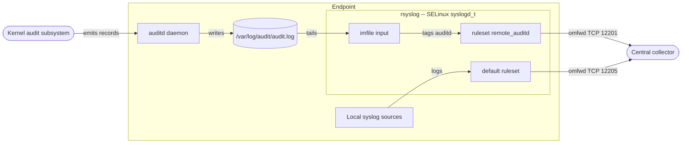
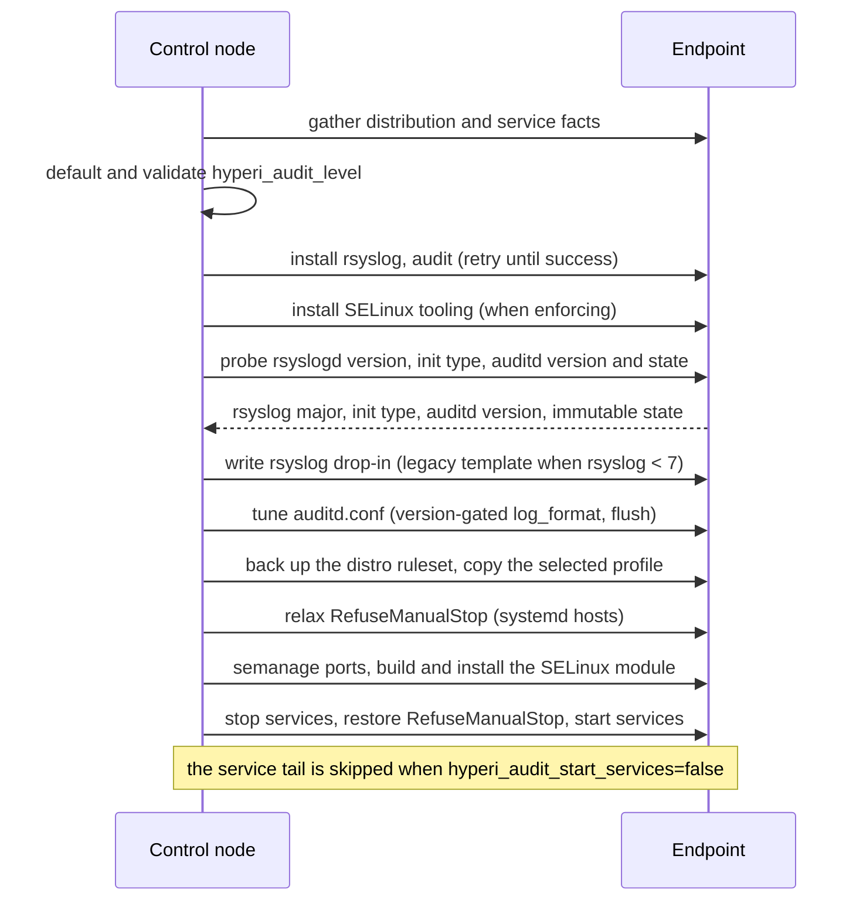

<!--
Project:      HyperI Linux audit collector
File:         ARCHITECTURE.md
Purpose:      The code map -- pipeline, deployed artefacts, profile tiers,
              deploy order, the invariants a maintainer must not break, and
              what the test harness does and does not prove.
License:      BUSL-1.1
Copyright:    (c) 2026 HYPERI PTY LIMITED
-->

# Architecture

This repo is one Ansible role that turns a Linux endpoint into an audit source:
auditd writes records to a file, rsyslog tails that file and forwards it to the
central collector over TCP. Nothing else is installed -- the small component
count is the design, not an omission, and it is what lets one role span
end-of-life and current distros alike (see
[the ADR](docs/decisions/0001-auditd-to-file-to-rsyslog-not-audisp.md)).

## Two streams, two ports, one transport

Audit records and general syslog both leave the host through rsyslog, but on
**different collector ports**: audit on **TCP 12201**, everything else on **TCP
12205**. One daemon, one config file, two destinations.

The template is chosen from the rsyslogd major version probed on the endpoint.
On rsyslog >= 7 both forwards are `omfwd` actions with
`action.resumeRetryCount="100"` and a 10,000-entry linked-list queue, so a
collector outage buffers rather than drops, and the audit input is bound to its
own `remote_auditd` ruleset. Below 7 the role swaps in the legacy template,
which is pre-RainerScript: `$ModLoad imfile`, plain `@@host:port` forwarding
with no queue or retry options, and a `$programname == 'auditd'` check plus
`stop` in place of the dedicated ruleset.

SELinux is a boundary concern with two halves, applied only when
`ansible_selinux.status == 'enabled'`:

- **Egress**: `semanage port -a -t syslogd_port_t -p tcp` for 12201 and 12205,
  so `syslogd_t` may connect out on those ports.
- **Read**: the `rsyslog_read_audit_logs` policy module grants
  `logging_read_audit_log(syslogd_t)`, so imfile may read the audit log at all.
  It is compiled on the endpoint against `/usr/share/selinux/devel/Makefile`
  and installed with `semodule`.

## What gets deployed, and where it lands

| Artefact | Destination on the endpoint |
|---|---|
| Packages | `rsyslog` + `audit` (`auditd` on Ubuntu/Debian/SLES); `policycoreutils*` and `libselinux-python` where SELinux is enabled |
| rsyslog forwarder | `/etc/rsyslog.d/99-hyperi-rsyslog.conf` (0644 root:root) |
| Drop-in include | `$IncludeConfig /etc/rsyslog.d/*.conf` appended to `/etc/rsyslog.conf`, so the drop-in is read on every rsyslog version |
| Audit ruleset | `/etc/audit/rules.d/hyperi-audit.rules`, or `/etc/audit/audit.rules` when auditd major version is 1 |
| Displaced distro ruleset | copied aside to `<default rules path>.default` |
| auditd tuning | the `auditd.conf` discovered under `/etc` (edited line-by-line, not templated over) |
| SELinux policy | built in `/tmp/rsyslog_audit`, installed via `semodule`, build directory then removed |

The auditd tuning is a fixed set: `name_format=hostname`, `log_group=root`,
`max_log_file=100`, `num_logs=5`, `max_log_file_action=ROTATE`, `freq=200`,
plus the version- and profile-gated `log_format`, `flush` and `priority_boost`
described below.

## Profile tiers trade breadth against host cost

The axis is **detection breadth vs host CPU and forwarding bandwidth**. Every
profile carries the same base configuration and the same anti-tamper posture;
they differ in how much syscall-level volume they ask the kernel to generate
and the link to carry.

| Profile | Selected by | For | Trade |
|---|---|---|---|
| `low` | `hyperi_audit_level=low` | Constrained hosts, slow links | Drops the high-volume syscall auditing (per-connection network, DAC perm-mod, user file deletion, IPC, io_uring/namespace breadth). Backlog 8192, `priority_boost=2` |
| `medium` | `hyperi_audit_level=medium` (default) | The general fleet | Balanced. Backlog 8192, `priority_boost=4` |
| `high` | `hyperi_audit_level=high` | High-value hosts that can carry it | `medium` plus interpreter exec, the full setuid/DAC syscall family, IPC, recon toolset, data staging, session/PAM, third-party agents. Backlog 16384, `priority_boost=4` |
| `internet` | `hyperi_audit_profile_override=internet` | Internet-facing edge (web, proxy, bastion) | `medium` minus per-connection network logging, on the assumption the edge NIPS/firewall already carries that telemetry |

Selection logic, from `tasks/main.yml`:

- `hyperi_audit_level` defaults to `medium`, and the play **fails** on anything
  outside `low|medium|high`.
- A non-empty `hyperi_audit_profile_override` **replaces** the level's rules file
  outright -- it is not merged. `level=high` with `profile_override=internet`
  deploys the `internet` file, which is `medium`-based; there is no high-based
  internet variant unless someone writes one. The play **fails** on an override
  outside `low|medium|high|internet`, and **warns** when an override is set
  alongside a non-default level (the level is discarded).
- `collector_address` is required; the play fails without it.
- `hyperi_audit_start_services` (default true) gates the whole service tail.

## Deploy order

Facts and probes come first, because almost everything after them is gated on a
version discovered on the endpoint rather than assumed from the distro name.

Version gating lives in two places and nowhere else: `log_format` is `ENRICHED`
at auditd >= 2.8 and `RAW` below it; `flush` is `incremental_async` at >= 2.6
and `incremental` below it (el6 ships audit 2.4.x).

## Invariants a maintainer must not break

These are the expensive ones. Each is load-bearing and none is obvious from the
line it sits on.

1. **`-i` stays first in every ruleset, and stays a runtime skip.** It makes a
   directive, syscall or field the running kernel does not know skip at load
   instead of aborting the load. It must **not** become a static auditd-version
   gate: the skip is per-host correct because it reacts to the real kernel, so a
   host with old auditd but a new kernel (Ubuntu 16.04: auditd 2.4.5, kernel
   4.x) keeps `--backlog_wait_time 0`, while el6 drops it. A version gate would
   wrongly strip the CPU fix from that host.
2. **auditd.conf is the opposite, and is version-gated in `tasks/main.yml`.** An
   unknown keyword or value there is fatal at daemon start -- there is no `-i`
   equivalent. That is why `log_format` and `flush` are gated on the probed
   auditd version and the rules directives are not.
3. **The escalated-execution (`euid=0`) block stays above the excludes.** The
   exit filter is first-match-wins and the excludes match on `auid`+`path` with
   no euid scoping, so below them `sudo cat /tmp/x` goes unlogged. Do not "fix"
   this by euid-scoping the excludes instead: `auid=unset` is 4294967295, which
   **is** `>=1000`, so that would un-exclude every daemon and flood the backlog.
4. **Never append a syscall to an existing `-S` list.** One unknown syscall name
   makes auditctl drop the *whole rule*, not just that name -- and `-i` hides the
   failure. Every new syscall goes on its own line.
5. **b64-only, with a 32-bit ABI tripwire.** The rules assume a 64-bit host; the
   `-F arch=b32 -S all -F key=32bit-abi` rule exists to make a 32-bit host
   announce itself rather than silently go unaudited.
6. **`-e 2` stays last** -- and because it does, every host is immutable from the
   second deploy onward. Do not re-gate the auditd restart on immutability:
   immutability blocks the kernel-side rules (which land at the next reboot), not
   the daemon-side `auditd.conf` tuning, and gating the restart strands that
   tuning on every already-deployed host.
7. **Dual `-k` keys are deliberate.** Where a rule carries both a MITRE key and
   an upstream Sigma key, the Sigma key is matched literally by SigmaHQ rules.
   Tidying it away silently kills that detection. One rule with two keys costs
   nothing extra.

## The test boundary: green means "configured and forwarding"

Be blunt about this. A green harness run proves the config is written correctly
and that the `imfile -> omfwd` path forwards to the collector. It does **not**
prove the auditing works.

The kernel audit subsystem is host-global (`NETLINK_AUDIT` is not per-netns), so
a container structurally cannot participate. Consequently, in the harness:

- **The rules are never loaded**, so no rule is ever proven to fire. A ruleset
  auditctl would reject, or a detection masked by an exclude ordered above it,
  passes here.
- **The service tail never runs** (it converges with
  `hyperi_audit_start_services: false`, because a plain container has no init),
  so the enable/stop/start path and the immutable-config handling are untested.
- **auditd is never started**, so nothing proves `auditd.conf` is even parseable
  by the daemon.

The harness seeds a marker into `audit.log` instead, which exercises the whole
forwarding contract without a real kernel event. Closing these gaps needs a
privileged disposable VM, not a container.

## See also

- [`docs/SUPPORTED-DISTROS.md`](docs/SUPPORTED-DISTROS.md) -- the distro range
  and why end-of-life releases are in scope.
- [`test/README.md`](test/README.md) -- the harness design, in full.
- [`docs/decisions/`](docs/decisions/) -- architecture decision records.
