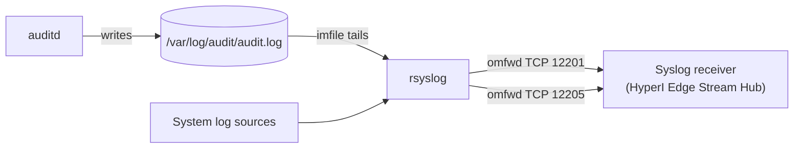

<!--
Project:      HyperI Linux audit collector
File:         docs/README.md
Purpose:      Landing page for the documentation set -- what this is and a
              linked map of the guides.
License:      Apache-2.0
Copyright:    (c) 2026 HYPERI PTY LIMITED
-->

# Documentation

This is one Ansible role that turns a Linux endpoint into an audit source: it
installs and tunes `auditd`, deploys a chosen audit ruleset, and configures
`rsyslog` to forward audit and system events to a central syslog receiver over
TCP. It spans a wide distro range, current releases and end-of-life ones alike,
because the deployed footprint is deliberately small.

The receiver is **any syslog daemon** that accepts forwarded TCP syslog -
HyperI's is the [Edge Stream Hub](https://hyperi.io), but rsyslog, syslog-ng or
any equivalent works. The role only sends standard syslog; it assumes nothing
about what receives it beyond a reachable `collector_address`.

The pipeline the role builds on each host:

Audit records leave on TCP 12201, everything else on TCP 12205.

## The guides

- [Getting started](getting-started.md) -- deploy the role to a single host and
  confirm it is auditing and forwarding. Start here.
- [Deploying to a fleet](deploying-to-a-fleet.md) -- a batched rollout across
  many hosts once one host works.
- [Configuration](configuration.md) -- the complete role-variable reference, the
  audit profiles, and the `auditd.conf` tuning the role applies.
- [Transport](transport.md) -- the opt-ins beyond the plaintext default: `relp`
  for reliable delivery, `syslog-tls` for encryption, `relp-tls` for both, and
  the TLS trust model to pick per receiver.
- [Supported distributions](SUPPORTED-DISTROS.md) -- the distro range and why
  end-of-life releases are in scope.
- [Deploying to legacy targets](deploying-to-legacy-targets.md) -- reaching
  el6-era hosts from a modern control node (pinned ansible, old-cipher SSH).

## Operating and safety

- [Security considerations](security-considerations.md) -- the transport is
  plaintext (put a TLS tunnel in front), and the role takes over the host audit
  config. Read before deploying to production.
- [Troubleshooting](troubleshooting.md) -- the common failures and their fixes.
- [Uninstall](uninstall.md) -- removing the collector and restoring the host.

## Going deeper

- [Architecture](../ARCHITECTURE.md) -- how the pieces fit, the deploy order, and
  the invariants a maintainer must not break.
- [Decisions](decisions/) -- the architecture decision records, including why the
  transport is `auditd -> file -> rsyslog` rather than audisp.
