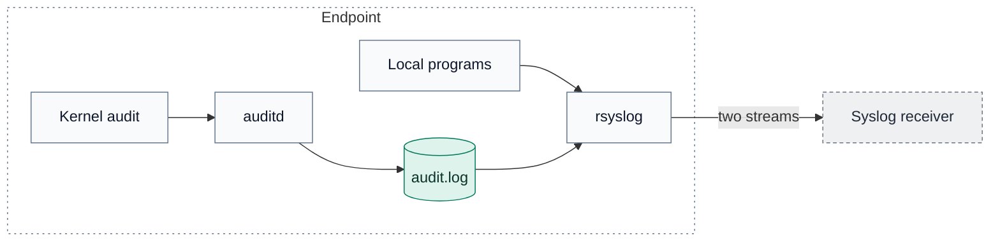
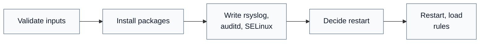

# edge-integration-linux architecture

edge-integration-linux is one Ansible role, `hyperi_audit`, that turns a Linux host into an audit source: auditd writes kernel audit records to a file, and rsyslog follows that file and forwards it, with the host's syslog, to a syslog receiver such as EdgeStream Hub.

*Figure 1. L3 Components -- edge-integration-linux endpoint. The dashed box is outside the role.* Up: top of edge-integration-linux.

## How data flows

Audit records and syslog leave the host through one rsyslog, on two receiver ports. The steps match Figure 1.

1. Kernel audit matches each syscall and file access against the loaded ruleset and hands matching records to auditd.
2. auditd writes them to `/var/log/audit/audit.log`, named with the host name.
3. rsyslog follows `audit.log` with its `imfile` input, tags each line `auditd`, and sends it through a separate ruleset to the audit port, TCP 12201 by default.
4. Everything rsyslog receives from local programs goes to the syslog port, TCP 12205 by default. The audit lines never reach that catch-all, so each record arrives once.
5. Each stream has a separate disk-assisted queue. While the syslog receiver is unreachable, records spool to rsyslog's work directory, up to 1 GB a stream, survive an rsyslog restart, and retry without limit.

The transport is plain TCP unless you pick TLS or RELP ([transport](transport.md)).

## Components

| Part | Role | Page |
|---|---|---|
| Kernel audit | Holds the ruleset the role renders, and drops events rather than block a syscall when its backlog fills. | [rulesets](rulesets.md) |
| auditd | The distro's audit daemon. The role sets nine `auditd.conf` values and loads the rules. | [configuration](configuration.md#auditdconf) |
| audit.log | The file between auditd and rsyslog, readable by rsyslog's group. | [ADR 0001](decisions/0001-auditd-to-file-to-rsyslog-not-audisp.md) |
| Local programs | Anything that logs through syslog on the host. | |
| rsyslog | The distro's rsyslog with one drop-in, `/etc/rsyslog.d/99-hyperi-rsyslog.conf`. | [transport](transport.md) |

## External dependencies

The role installs nothing beyond the distro's packages: `rsyslog`, `audit` (`auditd` on Debian, Ubuntu and SLES), `rsyslog-gnutls` for `syslog-tls`, `rsyslog-relp` for RELP, and the SELinux policy tools on SELinux hosts. It upgrades `rsyslog` and the audit package to the distro's latest release on every run.

The syslog receiver is the one swappable part. Any receiver that takes syslog over TCP works, and EdgeStream Hub is HyperI's (https://hyperi-io.github.io/edgestream-hub/). Ansible runs on a control node and reaches each host over SSH, so the hosts need no agent.

## Deployment variants

The role runs the same tasks on every host in the same order, and each task decides from what it finds on the host.

*Figure 2. L4 Detail -- Role task flow. The SELinux policy is written on SELinux hosts, and the last two steps are skipped when `hyperi_audit_start_services` is false.* Up: [L3 Components -- edge-integration-linux endpoint](architecture.md).

What changes from host to host:

| Host | Gets | Because |
|---|---|---|
| rsyslog below 7 (el6) | A legacy template in the old directive syntax, and no RELP | RainerScript and a usable librelp arrived in rsyslog 7 |
| audit below 2.8 or 2.6 | `log_format = RAW`, `flush = incremental` | Older auditd will not start on the newer values |
| Debian and Ubuntu | `log_group = adm` | rsyslog runs as `syslog` in group `adm` and must read `audit.log` |
| SELinux enabled | A policy module letting rsyslog read the audit log, and port labels for the receiver ports | `syslogd_t` can do neither by default |
| el6 | `USE_AUGENRULES="yes"` | Its init script otherwise ignores `rules.d` |
| Kernel locked by `-e 2` | `auditd.conf` changes at restart, new rules at the next reboot | The kernel rejects rule changes until reboot |

## Design considerations

- Both streams are plaintext by default, and `syslog-tls` or `relp-tls` encrypts them. [Security considerations](security-considerations.md) covers what the role changes on the host.
- The disk-assisted queues hold records through a receiver outage. `--backlog_wait_time 0` trades lost events for a host that never stalls on a full kernel backlog.
- The role fingerprints each service's config, `auditd.conf` and `rules.d` for auditd and `rsyslog.conf` and `rsyslog.d` for rsyslog. It restarts a service when its fingerprint differs from the one in `/var/lib/hyperi_audit/applied.json`, and writes that file only after the restart and rule load succeed. A run that fails part-way is finished by the next one. It then logs how many of the merged rules the kernel holds.
- Every rule costs each syscall it can match, so the ruleset uses the cheapest form each watch allows ([the cost of a rule](rulesets.md#the-cost-of-a-rule)).

## Why it's built this way

- Audit goes auditd to a file to rsyslog, not through audisp. audisp changes shape across the supported range and rsyslog does not ([ADR 0001](decisions/0001-auditd-to-file-to-rsyslog-not-audisp.md)).
- One template with levels and overlays, written beside the distro's rules. One file to review, rules that suit each host, and no host loses the rules it had ([ADR 0002](decisions/0002-layered-ruleset-and-dir-watch-form.md)).
- `-i` is a runtime skip, not a version gate. It skips what the running kernel does not know, so a host with old userspace and a newer kernel keeps every rule its kernel supports.
- `auditd.conf` is version-gated. auditd has no skip for an unknown setting and will not start, so those two values follow the probed audit version.
- `-e 2` stays last. It locks the rules, so even root cannot unload them without a reboot.

## Diagram map

- [Figure 1. L3 Components -- edge-integration-linux endpoint](architecture.md)
  - [Figure 2. L4 Detail -- Role task flow](#deployment-variants)
  - [L4 Detail -- Ruleset layers](rulesets.md)
  - [The accepted and rejected transports, ADR 0001](decisions/0001-auditd-to-file-to-rsyslog-not-audisp.md)

## What's next

- [Configuration](configuration.md) for every variable, level and overlay.
- [Rulesets](rulesets.md) for rule order, cost and how to add a rule.
- [Transport](transport.md) for TLS and RELP.
- [CONTRIBUTING.md](../CONTRIBUTING.md#context) for how to work in this repo.
