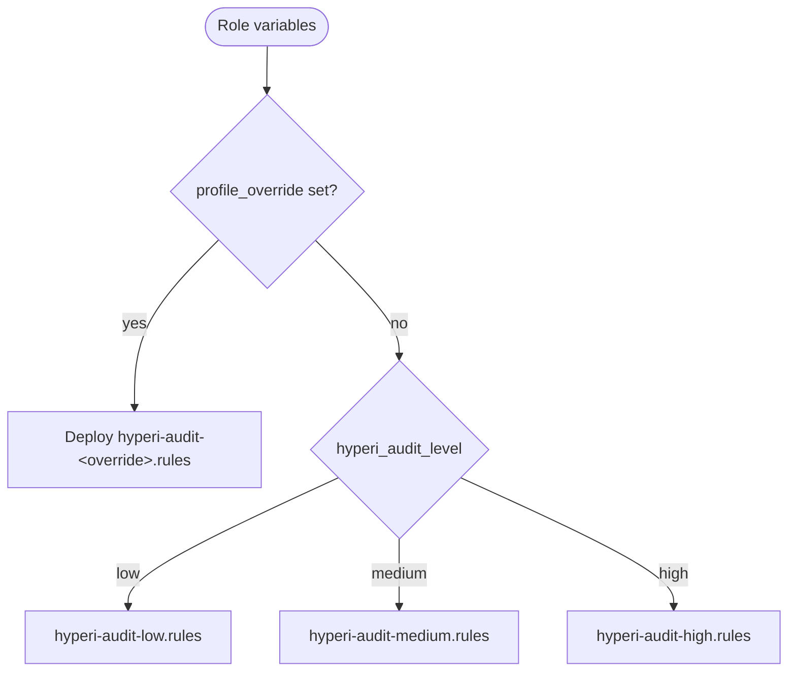

<!--
Project:      HyperI Linux audit collector
File:         docs/configuration.md
Purpose:      Reference -- the complete role-variable set, the audit profiles,
              and the auditd.conf tuning the role applies.
License:      Apache-2.0
Copyright:    (c) 2026 HYPERI PTY LIMITED
-->

# Configuration

The role is driven by a handful of variables and one profile choice. This page is
the look-up reference: every variable with its type, default and effect, then what
each audit profile contains, then the `auditd.conf` tuning the role applies. The
transport variables have their own page -- this table names them and
[transport](transport.md) covers RELP and the TLS trust models. Set the
variables in your inventory's `vars:` block or via `--extra-vars`.

## Role variables

| Variable | Type | Default | Effect |
|---|---|---|---|
| `collector_address` | string (IP or DNS name) | none -- **required** | The collector that receives the forwarded streams: audit on TCP 12201, general syslog on TCP 12205. The run **fails immediately** if unset. |
| `hyperi_audit_level` | `low` \| `medium` \| `high` | `medium` | Selects the audit ruleset by depth. Any other value **fails** the run. |
| `hyperi_audit_profile_override` | `low` \| `medium` \| `high` \| `internet` | unset | **Replaces** the level's ruleset with a named profile -- it does not layer on top. An unknown value **fails** the run. Setting it alongside a non-default `hyperi_audit_level` **warns**, because the level is then discarded. Formerly `hyperi_audit_use_case`. |
| `hyperi_audit_transport` | `tcp` \| `relp` \| `syslog-tls` \| `relp-tls` | `tcp` | Transport for both streams. `tcp` is plain syslog (default, works everywhere); `relp` adds reliable delivery; `syslog-tls` adds encryption; `relp-tls` both -- see [transport](transport.md). Any other value **fails** the run. |
| `hyperi_audit_tls_mode` | `anon` \| `server` \| `mutual` | `anon` | Trust model for the TLS transports. `anon` = encryption only; `server` = validate the receiver, no client cert; `mutual` = client cert. `relp-tls` rejects `server`. Ignored when `transport: tcp`. |
| `hyperi_audit_tls_ca_file` / `_client_cert` / `_client_key` / `_permitted_peer` | string (path / name) | unset | Certificate material for `server` and `mutual`. The CA is required for both; the client cert and key for `mutual`. Full detail in [transport](transport.md). |
| `hyperi_audit_port_audit` / `hyperi_audit_port_syslog` | string (port) | `12201` / `12205` | The forward ports. Point them at the receiver's TLS listeners (e.g. 6514) when using a TLS transport; the SELinux egress grant follows whatever you set. |
| `hyperi_audit_start_services` | boolean | `true` | `true` enables, stops and starts `auditd` and `rsyslog` as part of the run. `false` writes the configuration only and never touches services -- used by the test harness to converge inside a container that has no init. |

`hyperi_audit_profile_override` replaces rather than merges, so when it is set
`hyperi_audit_level` has no effect. Selecting `level=high` with
`profile_override=internet` deploys the `internet` ruleset, which is
`medium`-based -- there is no high-based internet variant unless someone writes
one.

## Audit profiles

The axis across every profile is **detection breadth versus host CPU and
forwarding bandwidth**. Breadth accrues and CPU does not, so pick for the host
rather than defaulting to the widest. Each profile ships as a single
`roles/hyperi_audit/files/hyperi-audit-<profile>.rules` file; all share the same
base configuration, anti-tamper posture and 64-bit assumption, and differ only
in how much syscall-level volume they ask the kernel to generate.

| Profile | Selected by | For | Contains |
|---|---|---|---|
| `low` | `hyperi_audit_level: low` | Constrained hosts, slow links | The high-signal file and exec watches plus the cheapest kernel TTPs. **Drops** the high-volume syscall auditing: per-connection network, DAC permission changes, user file deletion, IPC, and the io_uring / namespace breadth. |
| `medium` | `hyperi_audit_level: medium` (default) | The general fleet | Balanced host telemetry. The starting point unless you have a reason to move. |
| `high` | `hyperi_audit_level: high` | High-value hosts that can carry the volume | `medium` **plus** interpreter exec, the full setuid/DAC syscall family, IPC, the recon toolset, data staging, session/PAM, and third-party agents. Not for constrained or slow-link endpoints. |
| `internet` | `hyperi_audit_profile_override: internet` | Internet-facing edge (web servers, reverse proxies, bastions) | `medium` **minus** per-connection network logging, on the assumption an edge NIPS and firewall already carry that telemetry. Everything else is retained. |

Two of the settings vary with the profile:

- **Kernel backlog** (the `-b` rule directive): `8192` for `low`, `medium` and
  `internet`; `16384` for `high`. With the paired `--backlog_wait_time 0` fix the
  kernel drops on overflow rather than throttling the host, so more backlog means
  fewer lost events under burst.
- **`priority_boost`** (see the tuning table below): `2` for `low`, `4` for
  `medium` and `high`.

The rulesets carry their own lineage -- the merge order across the public
baselines (Neo23x0, ACSC, NIST, DISA STIG, alphagov/GDS, US DoD, SigmaHQ), the
MITRE ATT&CK key mappings, the SigmaHQ alignment and the load-order traps -- in
the `# HISTORY.` header of each `.rules` file. Read that header before editing a
ruleset. For how the profile is selected and copied into place at deploy time,
see [ARCHITECTURE.md](../ARCHITECTURE.md).

## auditd.conf tuning

The role edits the distro's `auditd.conf` line by line (it does not template a
whole file over the top), applying a fixed set of values plus three that are
gated on the profile or the probed `auditd` version.

| Setting | Value | Notes |
|---|---|---|
| `name_format` | `hostname` | Tags every record with the host's name, so the collector can attribute forwarded records. |
| `log_group` | `root` | Group ownership of the log. |
| `max_log_file` | `100` | Per-file cap in MB. |
| `num_logs` | `5` | Rotated files kept. |
| `max_log_file_action` | `ROTATE` | Rotate rather than halt or suspend on a full log. |
| `freq` | `200` | Records between flushes -- raised to cut fsync-induced iowait on the write path. |
| `priority_boost` | `2` (low) / `4` (medium, high) | auditd's scheduling-priority boost. Lowered for `low` so a constrained host keeps more CPU for its workload. |
| `flush` | `incremental_async` at `auditd >= 2.6`, else `incremental` | Async fsync is the higher-performance durable mode but needs 2.6; el6 (audit 2.4.x) falls back. |
| `log_format` | `ENRICHED` at `auditd >= 2.8`, else `RAW` | ENRICHED resolves uid/gid/syscall names at write time; older auditd does not support it. |

The version gates exist because an unknown keyword or value in `auditd.conf` is
**fatal** at daemon start -- there is no per-line skip for it, unlike the ruleset.
That difference, and the rest of the deploy internals, is covered in
[ARCHITECTURE.md](../ARCHITECTURE.md).

## See also

- [Getting started](getting-started.md) -- deploy and verify a single host.
- [Deploying to a fleet](deploying-to-a-fleet.md) -- batched rollout across many
  hosts.
- [ARCHITECTURE.md](../ARCHITECTURE.md) -- pipeline, deploy order and the
  maintainer invariants.
- [Supported distributions](SUPPORTED-DISTROS.md) -- the distro range.
