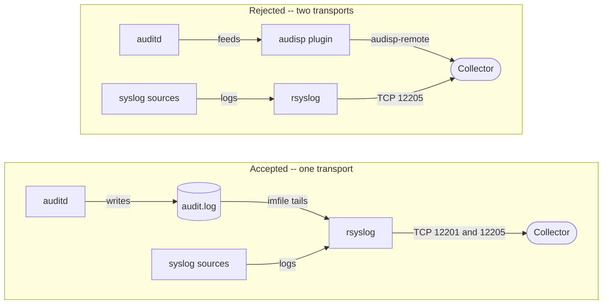

<!--
Project:      HyperI Linux audit collector
File:         docs/decisions/0001-auditd-to-file-to-rsyslog-not-audisp.md
Purpose:      ADR -- why audit records leave the endpoint via rsyslog reading
              audit.log, rather than via an audisp plugin.
License:      BUSL-1.1
Copyright:    (c) 2026 HYPERI PTY LIMITED
-->

# 1. auditd -> file -> rsyslog, not audisp

## Status

Accepted.

## Context and problem statement

We ship one collector across a distro range from el6 (auditd 2.4.x, kernel
2.6.32) to current, end-of-life releases explicitly included -- see
[`../SUPPORTED-DISTROS.md`](../SUPPORTED-DISTROS.md) for why the old boxes are a
product feature rather than legacy debt. Audit records have to reach a central
collector from every one of them.

Across that range, every extra moving part multiplies the
distro/version/dependency matrix we have to keep working. The endpoints at the
bottom of the range are also the ones least able to absorb a new dependency: an
unavailable package, a python or library version conflict, or a component that
was restructured mid-range costs us the whole distro.

## Decision

Read `/var/log/audit/audit.log` with rsyslog's `imfile` and forward it with
`omfwd`. Do **not** use audisp/audispd plugins.

## Rationale

- **audisp is fragmented across the range.** It is a separate `audispd` daemon
  configured under `/etc/audisp/plugins.d` in audit 2.x (RHEL/CentOS 5/6/7), and
  was deprecated and restructured in the audit 3.x era -- merged into `auditd`
  with plugins under `/etc/audit/plugins.d`. One transport with two different
  shapes and two different config locations, split down the middle of the range
  we support.
- **rsyslog is a constant, and we need it anyway.** It is present or trivially
  available on every target, and the role deploys it regardless for the general
  syslog stream. Forwarding audit through it adds a config file, not a component.
- **The collector is a syslog receiver.** It consumes syslog-shaped lines, not
  native audisp records, so audisp would need a translation layer that the file
  path does not.
- **Fewer components, fewer failures.** Each one we drop removes inter-distro
  incompatibilities, python and library dependency breakages, and local disk
  consumption. On a fifteen-year distro span that is the difference between a
  role that deploys and a role that needs a per-distro exception.

## Consequences

Good:

- **One transport, both streams.** Audit and general syslog leave the host
  through the same daemon, the same queueing and retry behaviour, and the same
  SELinux port grants -- just on different collector ports.
- **A much smaller dependency surface.** Nothing to install, version-gate or
  reconcile beyond rsyslog and auditd themselves.
- **The forwarding path is testable without a kernel.** Because the contract is
  "a line appears in the file, a line arrives at the collector", the container
  harness can seed `audit.log` and prove the whole path. An audisp socket
  consumer could not be exercised that way.

Bad, and we accept it:

- **No audisp enrichment -- records are raw.** The kernel hex-encodes any argv
  element that contains a quote or a byte outside `0x21-0x7e`, space included.
  So `execve` of `ls -l "my file"` arrives with the affected `a*` fields as hex
  strings. Tooling that expects `ausearch -i`-style decoding will not see those
  decoded, and any decoding is the pipeline's job downstream, not the endpoint's.
- This does **not** break record-scoped consumers. Audit records are
  self-contained per line, so a line that arrives is a complete record --
  hex-encoded fields and all. The loss is readability and enrichment, not
  integrity or event boundaries.
- Partial mitigation only: the role sets `log_format = ENRICHED` where auditd
  supports it (>= 2.8), which resolves numeric ids to names at the daemon. It
  does not decode hex-encoded argv.

## More information

- [`../../ARCHITECTURE.md`](../../ARCHITECTURE.md) -- the pipeline, ports and
  SELinux boundary this decision produces.
- [`../SUPPORTED-DISTROS.md`](../SUPPORTED-DISTROS.md) -- the distro range that
  drives it.
- [`../../test/README.md`](../../test/README.md) -- what the harness proves about
  the forwarding path, and what it cannot.
