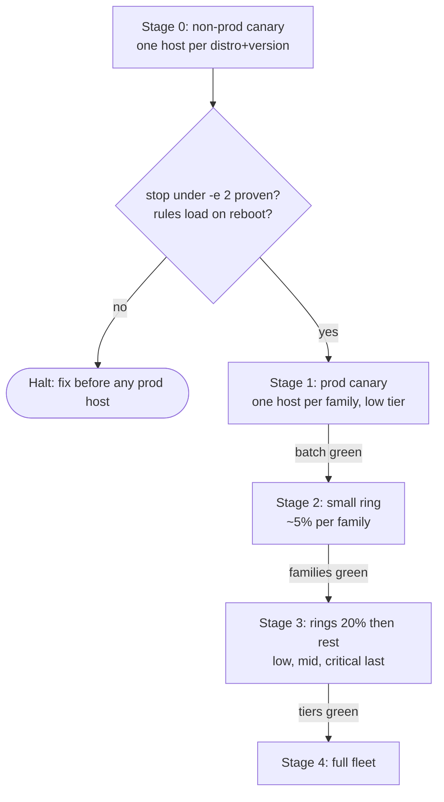
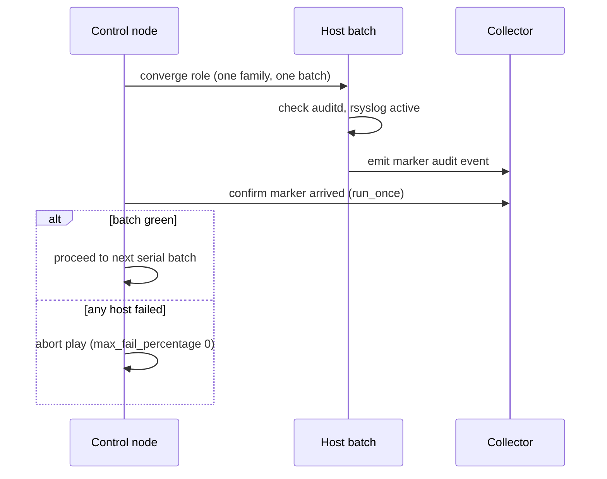

<!--
Project:      HyperI Linux audit collector
File:         docs/deploying-to-a-fleet.md
Purpose:      How-to -- roll the role out across a fleet in incremental,
              blast-radius-controlled batches keyed on distro+version.
License:      Apache-2.0
Copyright:    (c) 2026 HYPERI PTY LIMITED
-->

# Deploying to a fleet

Rolling this role across a fleet is a staged rollout with a controlled blast
radius, not a fan-out. The role **takes over** host auditing: it renames the
distro's own ruleset aside to `.default`, installs the HyperI rules, rewrites
`auditd.conf`, then **stops and starts** `auditd` and `rsyslog` (see
[ARCHITECTURE.md](../ARCHITECTURE.md)). A failed run therefore breaks auditing on
every host it touches *in that run*, so the batch -- not the host -- is the unit
of risk. Get one host right first with [getting started](getting-started.md),
then use this page to scale it out.

The model, tightest blast radius first: prove the risky behaviour on one real
host per distro+version, ramp `serial` batches from a single canary out to full
rings, gate every batch on a forwarding proof, and run the play once per distro
family. There is **no built-in undo**.

## Why a fleet rollout needs extra care

- **It replaces auditing rather than adding to it.** The stop/start of `auditd`
  is the dangerous moment: a host that fails mid-swap can be left with no running
  audit daemon. That is a security regression, not merely a failed deploy.
- **The code forks on distro+version.** `log_format`, `flush`, the rsyslog legacy
  template and the rules path all branch on the `auditd`/`rsyslog` version probed
  on the endpoint ([ARCHITECTURE.md](../ARCHITECTURE.md); the range is in
  [SUPPORTED-DISTROS.md](SUPPORTED-DISTROS.md)). Distro+version is the natural
  batch axis -- a batch that straddles families runs two code paths at once and
  blurs which one broke. **Run the play once per family.**
- **One behaviour in that path is unproven.** See the next section. It is the
  primary reason Stage 0 exists.
- **Rules land at the next reboot; config lands now.** The rulesets end with
  `-e 2` (immutable), so from the second deploy onward the kernel refuses new
  rules until the host reboots -- only the `auditd.conf` tuning applies on the
  in-run restart. Verify the ruleset *after* the planned reboot, not just after
  the play.

## Stage 0's job: prove the immutable-stop question

The role stops `auditd` to swap the ruleset. It is **UNVERIFIED** whether the
older `auditd` in range (2.4.x on el6 upward) refuses a manual stop while the
config is immutable (`-e 2`). A container cannot answer it -- audit netlink is
host-global, so the test harness never runs the service path at all
([ARCHITECTURE.md](../ARCHITECTURE.md), "the test boundary"). Answer it on real
hardware, per distro family, before any production host is in scope. If a stop is
refused the task fails loudly -- that loud failure on a throwaway host is exactly
the outcome Stage 0 is there to buy.

## The phased model



- **Stage 0 -- non-prod canary.** One host per distro+version family (el6, el7,
  el8, el9, Ubuntu, SLES...). Prove the immutable-stop question and that a reboot
  loads the rules. Bake long enough to span a real load cycle.
- **Stage 1 -- prod canary.** One host per family, lowest criticality tier,
  `serial: 1`, `max_fail_percentage: 0`.
- **Stage 2 -- small ring.** About 5% of each family.
- **Stage 3 -- expanding rings.** 20% then the remainder, ordered by criticality:
  low, then mid, **critical last**.
- **Stage 4 -- full fleet.** Only once every family and every tier is green.

## The one-play recipe

`site.yml` is one play against `all`. Add the ramp and the hard-stop; the role
stays as-is:

```yaml
- hosts: all
  max_fail_percentage: 0        # any host failing a batch aborts the whole play
  serial: [1, 5, "20%"]         # canary of 1, then 5, then 20% rings
  roles:
    - role: hyperi_audit
  # post_tasks health gate -- see below
```

`serial` splits one play into successive batches (ansible docs:
`playbooks_strategies`). `max_fail_percentage: 0` aborts the play when a batch's
failure rate is **exceeded** -- the percentage must be exceeded, not equaled
(ansible docs: `playbooks_error_handling`) -- so with `0` the *first* failing host
stops everything. For a canary of one that is the hard stop you want;
`any_errors_fatal: true` is the equivalent for a strict canary. The gate below is
what makes a batch "fail" for health reasons rather than only on a task error.

## Inventory: one host, many groups

A host belongs to several overlapping groups at once -- environment, criticality
tier, and distro+version family -- and you target rollout waves by intersecting
them. Child group vars override parent, so set `collector_address` once on `all`
(ansible docs: `intro_inventory`).

```yaml
# environments/prod
all:
  vars:
    collector_address: "203.0.113.9"     # one collector for the whole inventory
  children:
    staging:
      hosts:
        canary-el7.stg.example.net:
        canary-el9.stg.example.net:
    prod:
      hosts:
        app01.example.net:
        app42.example.net:
    el7:                                  # distro+version family = the batch axis
      hosts:
        canary-el7.stg.example.net:
        app01.example.net:
    el9:
      hosts:
        canary-el9.stg.example.net:
        app42.example.net:
    tier_low:                             # criticality = the Stage 3 order
      hosts:
        app01.example.net:
    tier_high:                            # crown jewels -- deployed last
      hosts:
        app42.example.net:
```

Per-tier or per-family overrides (for example a lighter profile on constrained
hosts) go in `group_vars/tier_low.yml` as `hyperi_audit_level: low` -- see
[configuration](configuration.md).

## Run the play once per family

Never let a `serial` batch straddle families. Drive each family with its own
`--limit`, using ansible's pattern algebra -- `:` union, `&` intersection, `!`
exclude, `@file` retry (ansible docs: `intro_patterns`):

```sh
# Stage 0: the el7 non-prod canary
ansible-playbook -i environments/prod site.yml --limit 'staging:&el7'

# Stage 1: the el7 prod canary, lowest tier only
ansible-playbook -i environments/prod site.yml --limit 'prod:&el7:&tier_low'

# Later el7 rings, everything except the crown jewels
ansible-playbook -i environments/prod site.yml --limit 'prod:&el7:!tier_high'

# Re-target only the hosts that failed the last run
ansible-playbook -i environments/prod site.yml --limit @site.retry
```

Repeat per family (`el8`, `el9`, `ubuntu24`...). For el6-era targets the control
node itself needs a pinned older ansible -- see
[deploying to legacy targets](deploying-to-legacy-targets.md).

## The between-batch health gate

Health is proven **inside** each batch as `post_tasks`. Because
`max_fail_percentage: 0` counts a failed post-task as a failed host, a red gate
blocks the next batch -- that is what turns the ramp into a graduated rollout.



Prove **forwarding**, not just that a process is up. Pick a signal attributable
to the change: "the marker reached the collector" is that signal, "the host's CPU
is fine" is not (SRE: `sre.google/workbook/canarying-releases`). This mirrors the
role's own test harness, which seeds a unique marker into `audit.log` and asserts
it arrives at the receiver on TCP 12201.

```yaml
  vars:
    fleet_marker: "HYPERI_FLEET_{{ inventory_hostname }}_{{ ansible_date_time.iso8601_basic_short }}"
  post_tasks:
    - name: auditd and rsyslog are active
      ansible.builtin.command: "systemctl is-active {{ item }}"
      changed_when: false
      loop: [auditd, rsyslog]

    - name: the collector's audit port is reachable from the host
      ansible.builtin.wait_for:
        host: "{{ collector_address }}"
        port: 12201
        timeout: 15

    - name: seed a unique marker into the audit log
      ansible.builtin.shell: >-
        echo "type=USER msg=audit($(date +%s).000:0): {{ fleet_marker }}"
        >> /var/log/audit/audit.log
      changed_when: false

    - name: confirm the marker reached the collector
      ansible.builtin.command: "grep -q {{ fleet_marker }} /var/log/hyperi/received.log"
      delegate_to: "{{ collector_address }}"
      run_once: true
      register: seen
      until: seen.rc == 0
      retries: 6
      delay: 5
      changed_when: false
```

Seeding the marker (rather than waiting for a real syscall event) proves the
`imfile -> omfwd` path independently of the rules, which under `-e 2` have not
loaded yet. Adapt the collector-side check to your receiver's log path or query.
`run_once` confirms the batch's canary; for a multi-host ring drop it so every
host's own marker is verified. After the **planned reboot**, add the real-rule
check: `auditctl -s` reports `enabled 2` and an audited action (an `id` under
sudo) shows up at the collector -- that is the proof the ruleset itself loaded.

## Rollback: there is no undo

Re-runs are idempotent (the role checks live immutable state and de-dups the
rsyslog include), so the forward fix is to correct the variables and re-apply to
`--limit @site.retry`. **No task reverses a deploy.** To restore a host by hand:

1. Move `<rules path>.default` back over the installed ruleset
   (`/etc/audit/rules.d/audit.rules`, or `/etc/audit/audit.rules` on auditd v1 --
   the role saved it aside).
2. Restore the distro's stock `auditd.conf` -- from config management, or by
   reinstalling the `audit`/`auditd` package's config.
3. Restore `RefuseManualStop=yes` in the systemd unit if the role left it relaxed.
4. Reboot (or restart `auditd` and `rsyslog`) so the kernel drops the HyperI
   rules.

Keep this runbook to hand before Stage 1 -- a graded rollout limits how many
hosts ever need it, but it does not remove the need.

## AWX / AAP (confirm against current AAP docs)

The same shape maps onto a Workflow Template: one Job Template per stage, chained,
with an **Approval node** between stages as the human gate, and per-stage
targeting by group or `--limit`. Job slicing can partition the inventory across
control nodes.

> **Note:** the AWX/AAP specifics here are **UNVERIFIED** against current AAP
> documentation. Confirm the Job Slicing and Workflow Approval behaviour -- in
> particular how job slicing interacts with `serial` -- against the current AAP
> docs before relying on it.

## See also

- [Getting started](getting-started.md) -- deploy and verify one host first.
- [Configuration](configuration.md) -- profiles and every role variable.
- [Supported distributions](SUPPORTED-DISTROS.md) -- the distro+version range that
  defines your families.
- [Deploying to legacy targets](deploying-to-legacy-targets.md) -- pinned ansible
  and old-cipher SSH for el6-era hosts.
- [ARCHITECTURE.md](../ARCHITECTURE.md) -- the pipeline, deploy order and the
  maintainer invariants.
