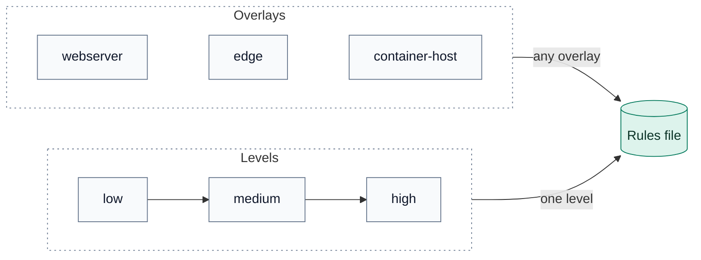

# Rulesets

The role renders one audit ruleset per host from `roles/hyperi_audit/templates/hyperi-audit.rules.j2`. The level sets how deep it goes, the overlays tune it for what the host does, and the order of the lines decides what the kernel logs.

Each level holds every rule of the level below it, and the overlays add or remove rules on top of whichever level you pick.

*Figure 1. L4 Detail -- Ruleset layers. Each arrow inside Levels means "adds to".* Up: [L3 Components -- edge-integration-linux endpoint](architecture.md).

The template renders on the host, so the rules match what is there. The webserver overlay resolves account names to that host's uids, and every directory watch takes the cheaper form where the directory exists ([the cost of a rule](#the-cost-of-a-rule)). What each level and overlay holds is in [configuration](configuration.md#levels).

The role writes `/etc/audit/rules.d/hyperi-audit.rules` and leaves every other file in `rules.d` alone. `augenrules` merges the directory in `ls -1v` order and keeps the last `-b`, `-f`, `--backlog_wait_time` and `-e` it reads. `hyperi-audit.rules` sorts after `audit.rules` and every `NN-*.rules`, so its control lines win, and a local file that sorts after it can override them.

The kernel checks rules in load order and the first one that matches an event decides it, file watches included. `test/lab/semantics.sh` checks this on a live kernel, and it holds on kernels 6.12, 6.8 and 5.14. The template is laid out around three consequences:

- A `never` rule silences the `always` rules loaded after it, never those before. Every exclude sits above the rules it is meant to quiet.
- The execution rules sit above the excludes, so no exclude can hide a root exec from `/tmp`.
- Distro files in `rules.d` load before `hyperi-audit.rules`. A broad `never` rule in one of them silences the matching HyperI rules.

The ruleset is forked from Florian Roth's (Neo23x0) "Best Practice Auditd Configuration" (https://github.com/Neo23x0/auditd, Apache-2.0), then merged in turn with the public baselines:

Neo23x0 (Florian Roth) -> ACSC (ASD) OpenSCAP -> NIST -> DISA STIG -> alphagov/GDS -> US DoD -> SigmaHQ

Keys carry MITRE ATT&CK technique ids where one maps. Rules marked `sigma:` in the template also let a SigmaHQ auditd rule fire where your pipeline runs SigmaHQ, and each is worth its cost without it. Their detection logic comes from SigmaHQ (https://github.com/SigmaHQ/sigma) under the Detection Rule License 1.1. The full changelog and the reasons behind individual rules are in [ruleset history](ruleset-history.md).

## Using a rules file on its own

Each profile is published as a plain auditd rules file, for any x64 or arm64 host, no Ansible needed:

| Profile | File |
|---|---|
| `low` | https://github.com/hyperi-io/edge-integration-linux/blob/main/rules/hyperi-audit-low.rules |
| `medium` | https://github.com/hyperi-io/edge-integration-linux/blob/main/rules/hyperi-audit-medium.rules |
| `high` | https://github.com/hyperi-io/edge-integration-linux/blob/main/rules/hyperi-audit-high.rules |
| `internet` | https://github.com/hyperi-io/edge-integration-linux/blob/main/rules/hyperi-audit-internet.rules |

Copy one to `/etc/audit/rules.d/hyperi-audit.rules` and run `augenrules --load`. The last line, `-e 2`, locks the rules until the next reboot, so check first: `augenrules --load` prints each rule the kernel rejects, and `auditctl -l | wc -l` against the file's rule count shows how many loaded. Other files in `rules.d` load too, and one that sorts after `hyperi-audit.rules` can change its settings. `internet` is `medium` with the `edge` and `webserver` overlays, its webshell rules set for uid 33 (`www-data`) and 48 (`apache`).

A syscall some supported host lacks, such as `open` on arm64 or `fchmodat2` before kernel 6.6, has a rule line of its own, so on that host only the line fails, and the `-i` at the top skips it. A directory missing on the host fails the same way. The files are generated from the template, and CI fails if they drift from it or if a heavier level stops holding every rule of the lighter one.

The role does four things a static file cannot:

- Points exec watches at the real binary. A watch on a symlink never fires, and `/usr/bin/python3`, `/bin/nc` and `/sbin/reboot` are symlinks on most distros.
- Watches each login account's `authorized_keys` (`medium`) and shell start-up files (`high`).
- Leaves out rules for components the host does not have, such as Puppet or SSSD.
- Watches a missing persistence directory for its creation, where the static file's rule fails to load.

## The cost of a rule

Every syscall walks each rule whose syscall mask includes it, so a rule with a wide mask costs the host on every syscall it makes. A `-w dir/` watch has every syscall in its mask and costs about 15 ns on each one. The same watch written as `-a always,exit -F arch=b64 -F perm=wa -F dir=` gets a mask of just the syscalls `perm=` covers, at about a quarter of that. Every rule also costs each syscall a mask check of about 2 ns, a file watch included, so the rule count sets a floor: 40 file watches added 72 ns to `getppid`.

The role stats each watched directory at deploy time and writes the cheaper form where it exists. A missing directory cannot take a `dir=` rule, so it keeps the `-w` form.

The table gives the median cost of one `getppid` call, the cheapest syscall there is, so the figure is the rule walk alone: the published file for each level against the rules it replaced. `test/lab/bench.sh` measured it in lab VMs in 2026-11. The same ruleset varied by up to 70 ns between runs, and re-running the bench gives the figure for your kernel. The role's per-host file has fewer rules than the published one, so it costs a little less.

| Ruleset | Debian 13, kernel 6.12 | Rocky 9, kernel 5.14 |
|---|---|---|
| Audit on, no rules | 160 ns | 162 ns |
| `low`, before and now | 547 to 621 ns | 494 to 502 ns |
| `medium`, before and now | 754 to 719 ns | 710 to 782 ns |
| `high`, before and now | 905 to 872 ns | 862 to 949 ns |
| `internet`, before and now | 739 to 761 ns | 748 to 840 ns |

Event volume matters more than the walk. Per-connection logging (`medium` and `high`, key `T1071_connect4`) is the largest source: at about 30K connects a second the backlog overflowed and over 100K events were lost, and with the `edge` overlay none were. `--backlog_wait_time 0` makes an overflow drop events rather than stall every process on the host.

## Adding a rule

Most mistakes here leave the ruleset loading cleanly while a detection goes quiet, so the kernel test is the check that counts.

1. Check every syscall name is in the x86_64 or aarch64 table (`ausyscall aarch64 --dump`). The role drops the names a host lacks before writing the file, because `auditctl` drops a whole rule over one unknown name. So `-S unlink -S unlinkat` covers x64 and arm64 in one line.
2. Key it `T<MITRE technique>_<what>`, such as `T1059_root_tmp`. Use a plain name, such as `audittools`, where no technique fits.
3. Keep every existing key. Keys are the output contract: rename one and every search and alert on it goes blind.
4. Where a SigmaHQ rule matches on a key name, put both keys on the rule (`-k T1071_connect4 -k network_connect_4`). Two keys cost nothing extra.
5. Put a `never` rule above every `always` rule it is meant to silence.
6. Watch a directory with the `wdir()` macro and add the path to `roles/hyperi_audit/vars/main.yml`. The render fails on a path missing from that list.
7. Most selective field first. The kernel stops at the first field that fails.
8. Add a row to `DETECTIONS` in `test/test_kernel.py` with a trigger, then run it in a lab VM or let the CI kernel job run it ([test/README.md](../test/README.md)).
