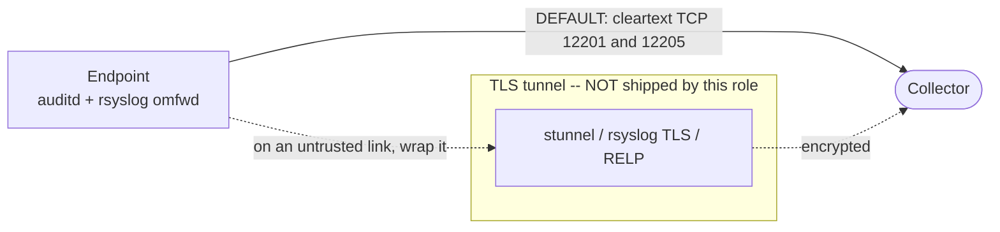

<!--
Project:      HyperI Linux audit collector
File:         docs/security-considerations.md
Purpose:      Reference -- the security properties and trade-offs of deploying
              this role, grounded in what the code actually does.
License:      Apache-2.0
Copyright:    (c) 2026 HYPERI PTY LIMITED
-->

# Security considerations

Read this before deploying to anything you care about. The role is small and
does one job well, but it makes deliberate trade-offs that an operator must
understand and, in one case, must compensate for. The headline: **the audit
stream leaves the host in cleartext**, and the role does nothing to encrypt it.
Everything else on this page is secondary to that.

## Transport is plaintext TCP -- there is no encryption

The rsyslog forwarder sends both streams with the `omfwd` action over plain TCP:
audit records to `collector_address` on **TCP 12201**, general syslog on **TCP
12205**. Neither template sets a TLS driver -- there is no `gtls`, no `ossl`, no
`StreamDriver`, no RELP anywhere in the role. The legacy (rsyslog < 7) template
is the same, forwarding with `@@host:port`. The stream is therefore **cleartext
on the wire**.

That matters because of *what* is on the wire. Audit records carry the commands
users ran, the files they touched, and authentication and privilege-escalation
events -- exactly the material an attacker who can sniff the link would want.
Sending it unencrypted across an untrusted network exposes it to interception
and to tampering in transit.

> **Warning:** This role does **not** set up encryption. On any link you do not
> fully trust -- anything crossing a data-centre boundary, a shared segment, or
> the public internet -- put a TLS tunnel between the endpoint and the receiver
> yourself. Options: `stunnel`, or rsyslog's own TLS (`gtls`/`ossl`) or RELP
> transport. Tellingly, the rulesets themselves watch `stunnel` execution as a
> covered-channel technique (MITRE ATT&CK **T1573.002**) -- the product already
> assumes tunnels exist in the environment; it just does not build one for you.

## The role takes over host auditing -- existing rules are displaced

This is not an additive role. It replaces the host's audit configuration:

- **Every ruleset begins with `-D`**, which flushes all existing kernel audit
  rules before loading the HyperI set.
- The distro's own rules file is **renamed aside** to `<path>.default`
  (`/etc/audit/rules.d/audit.rules.default`, or `/etc/audit/audit.rules.default`
  on auditd v1). It is a backup, not an active file: `augenrules` only merges
  files ending in `.rules`, so a `.default` file is **not** read back in. The
  displaced rules are saved but inert.
- **`auditd.conf` is rewritten** line by line (`name_format`, `log_group`,
  `flush`, `priority_boost`, log rotation and more -- see
  [configuration](configuration.md)).

> **Warning:** A host carrying bespoke, compliance, or STIG audit rules **loses
> them** on deploy -- they are backed up to `.default` but not loaded. Reconcile
> any existing rules into the chosen HyperI profile (or a site overlay) *before*
> deploying, or you trade one detection posture for another without noticing.

Note the asymmetry in what is backed up: the role backs up the **rules**
(`.default`) but does **not** back up `auditd.conf` -- it edits the live file in
place. Capture the stock `auditd.conf` from config management first if you may
need to restore it (see [uninstall](uninstall.md)).

## "Deployed" does not always mean "rules active"

Every ruleset ends with `-e 2`, which makes the kernel audit configuration
**immutable** until the next reboot. From the *second* deploy onward the host is
already immutable, so a re-run **cannot load the new rules** -- the kernel
refuses them until it reboots. The role's own comments and
[ARCHITECTURE.md](../ARCHITECTURE.md) spell this out.

The payload splits in two, and immutability blocks only half of it:

- **`auditd.conf` tuning** is daemon config, read at daemon start. It applies on
  the in-run restart even when the config is immutable.
- **The `.rules` file** is kernel state. Under `-e 2` it lands only at the next
  reboot.

So a green play run does not prove the new *rules* are active. Verify the
ruleset **after the planned reboot** -- `auditctl -s` reporting `enabled 2` and a
known audited action arriving at the collector -- not merely after the play. The
fleet guide builds this into its rollout gate
([deploying to a fleet](deploying-to-a-fleet.md)).

## There is a brief auditing gap during the deploy

To swap the ruleset the role **stops** `auditd`, then **starts** it again (and
does the same for `rsyslog`). Between the stop and the start there is a short
window in which the host is **not auditing at all**. On a fleet, a failed run can
leave a host with no running audit daemon -- a security regression, not just a
failed deploy. This is why the fleet rollout is staged and gated rather than a
fan-out; do not deploy to crown-jewel hosts first.

> **Note:** whether the older `auditd` in range (2.4.x on el6 upward) even
> *permits* a manual stop while the config is immutable is **UNVERIFIED** and
> must be proven on real hardware before production rollout -- a container cannot
> answer it. See [deploying to a fleet](deploying-to-a-fleet.md), "Stage 0".

## Privilege and network posture

- **Root on the endpoint.** The role runs with `become` as `root` -- it installs
  packages and writes under `/etc`. Grant it no less and no more.
- **SSH from the control node.** You drive the deploy over SSH from a control
  node with an account that can escalate; the endpoint needs no agent. For
  el6-era targets this includes an old-cipher SSH allowance -- see
  [deploying to legacy targets](deploying-to-legacy-targets.md).
- **Outbound only -- no inbound ports opened.** The role forwards *out* to the
  collector; it does **not** open a listening port on the endpoint. Where SELinux
  is enforcing it adds `syslogd_port_t` bindings for TCP 12201 and 12205, which
  permit rsyslog to *connect out* on those ports -- not to accept connections.
  The endpoint's attack surface does not grow by a listener.

## Profile choice is a security-versus-volume trade-off

The `low`/`medium`/`high`/`internet` profiles trade **detection breadth against
host CPU and forwarding bandwidth**. A higher profile detects more but generates
more events, costs more host CPU, and puts more on the (cleartext, see above)
link. Picking the widest profile for a constrained or slow-link host is its own
kind of risk. The selection mechanics and the per-profile contents are in
[configuration](configuration.md).

The detection lineage -- the merge order across the public baselines (Neo23x0,
ACSC, NIST, DISA STIG, alphagov/GDS, US DoD, SigmaHQ), the MITRE ATT&CK key
mappings and the SigmaHQ alignment -- lives in the `# HISTORY.` header of each
`roles/hyperi_audit/files/hyperi-audit-<profile>.rules` file. Read that header
before trusting or editing a ruleset; it is the authoritative record of what each
profile does and does not cover.

## See also

- [Uninstall](uninstall.md) -- the manual removal and restore runbook (there is
  no built-in undo).
- [Configuration](configuration.md) -- the profiles and every role variable.
- [Deploying to a fleet](deploying-to-a-fleet.md) -- staged rollout, the
  immutable-stop question, and the between-batch health gate.
- [Deploying to legacy targets](deploying-to-legacy-targets.md) -- pinned ansible
  and old-cipher SSH for el6-era hosts.
- [ARCHITECTURE.md](../ARCHITECTURE.md) -- the pipeline, deploy order and the
  maintainer invariants.
