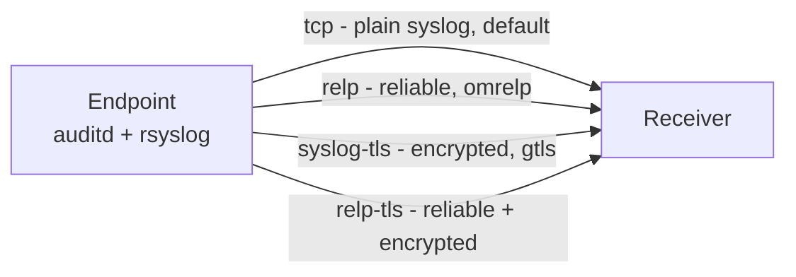

<!--
Project:      HyperI Linux audit collector
File:         docs/transport.md
Purpose:      The transport options beyond the plain-TCP default - reliability
              (RELP) and encryption (TLS) - and which trust model to pick per
              receiver.
License:      Apache-2.0
Copyright:    (c) 2026 HYPERI PTY LIMITED
-->

# Transport

The default transport is **plain TCP syslog** - it works against every receiver
and nothing here changes that. Two opt-ins sit on top of it: **RELP** adds
reliable, acknowledged delivery, and **TLS** adds encryption. One variable picks
the transport.

```yaml
hyperi_audit_transport: tcp   # tcp (default) | relp | syslog-tls | relp-tls
```

| Value | Transport | Reliable (ACK) | Encrypted | Reaches |
|---|---|---|---|---|
| `tcp` | plain syslog (`omfwd`) | no | no | any syslog receiver |
| `relp` | RELP (`omrelp`) | **yes** | no | any RELP receiver |
| `syslog-tls` | syslog over TLS (`omfwd` + gtls) | no | **yes** | any TLS syslog receiver |
| `relp-tls` | RELP over TLS (`omrelp` + TLS) | **yes** | **yes** | any RELP/TLS receiver |

Leave it unset and the role behaves exactly as before. RELP (`relp` / `relp-tls`)
needs the `rsyslog-relp` package and modern rsyslog - the role installs the
package and rejects RELP on the rsyslog<7 floor. The TLS transports need
`rsyslog-gnutls`.



## Reliability: RELP

RELP adds an **application-level acknowledgement** per message: the sender holds
each record until the receiver confirms it, and resends anything un-acknowledged
after a reconnect, so the in-flight window is not lost on a blip. Plain TCP syslog
has no such guarantee. For audit records that loss window is the gap RELP closes.

**RELP reaches any standard RELP receiver today** - an rsyslog `imrelp` listener,
syslog-ng, or equivalent. Both `relp` (plain) and `relp-tls` (encrypted) are
shipped; plain RELP is proven end to end in the test harness against a stock
`imrelp` receiver.

> **HyperI receivers - RELP is a future release.** HyperI's own receivers do not
> ingest RELP yet: the Edge Stream Hub's rsyslog front door has the `imrelp`
> listener drafted but disabled, and dfe-receiver has no RELP handler. Tracked by
> [edge-integration-linux#2](https://github.com/hyperi-io/edge-integration-linux/issues/2)
> and dfe-receiver#44. Until one lands, RELP reaches any standard RELP receiver
> but not a HyperI receiver - use `syslog-tls` for a HyperI destination today.

`relp` is reliable but **not encrypted**. For reliability *and* encryption use
`relp-tls` (below).

## Encryption: TLS

`syslog-tls` and `relp-tls` wrap the forwards in TLS. `syslog-tls` is the
recommended encrypted transport for a HyperI destination today - both the Edge
Stream Hub and dfe-receiver accept syslog-over-TLS.

### Trust model - `hyperi_audit_tls_mode`

How the endpoint trusts (or does not trust) the receiver. The right choice
depends on the receiver, because receivers use different TLS stacks.

```yaml
hyperi_audit_tls_mode: anon   # anon | server | mutual
```

| Mode | Endpoint presents | Verifies receiver | Needs | Suits |
|---|---|---|---|---|
| `anon` | nothing | no (encryption only) | nothing | Edge Stream Hub (rsyslog/gtls) over a trusted or VPN path |
| `server` | nothing | yes (validates the receiver cert) | `hyperi_audit_tls_ca_file` | dfe-receiver (rustls, `client_auth: none`) |
| `mutual` | a client cert | yes | CA + client cert + key | any receiver, when you run a PKI |

Only `mutual` requires a certificate on the endpoint. `anon` and `server` are
both "no client cert" - the difference is whether the receiver is authenticated.

The per-receiver split is what each TLS stack supports, not a preference:

- **Edge Stream Hub** fronts its pipeline with **rsyslog (gtls)**. gtls does
  `anon` (encryption only) or `mutual` (both ends present certs) cleanly; a
  one-way "validate the server, send no client cert" handshake is not its
  well-trodden path. So to ESH use **`anon`** or **`mutual`**.
- **dfe-receiver** is native Rust on **rustls**, which has **no anonymous
  ciphers** - it always presents a server certificate and never negotiates
  `anon`. So to dfe-receiver use **`server`** (one-way) or **`mutual`**.

### Caveats, stated plainly

- **`anon` does not authenticate the receiver** - it encrypts against a passive
  eavesdropper but not an active man-in-the-middle. Use it only where the path is
  already trusted (a VPN or controlled segment - ESH's own connectivity model),
  and move to `mutual` where it is not.
- **`anon` can fail on hardened hosts.** It relies on anonymous-DH ciphers, which
  modern crypto policies (RHEL8+, OpenSSL 3, recent GnuTLS) disable by default;
  the handshake then fails with "No supported cipher suites have been found".
  Where that happens, relax the crypto policy or use `mutual`.
- **`relp-tls` has no `server` mode.** librelp always negotiates mutual
  authentication for any authenticated mode, so `relp-tls` is `anon` or `mutual`
  only - the role rejects `relp-tls` with `server`.
- **The legacy floor (rsyslog < 7) has no RELP.** librelp there is too old or
  absent; the role fails `relp` / `relp-tls` on those hosts and points you at
  `syslog-tls` or `tcp`. syslog-over-TLS on the legacy floor uses the old
  `$Driver` directives and is emitted for you.

### Certificates

The role **consumes** certificate paths; it does not run a CA or issue certs.
Provision the files on the endpoint (config management, an image, or your PKI
tooling) and point the role at them:

```yaml
hyperi_audit_tls_ca_file: "/etc/pki/hyperi/ca.pem"         # server + mutual
hyperi_audit_tls_client_cert: "/etc/pki/hyperi/client.pem" # mutual only
hyperi_audit_tls_client_key: "/etc/pki/hyperi/client.key"  # mutual only
hyperi_audit_tls_permitted_peer: "collector.example.com"   # optional: pin the receiver name
```

For the low-maintenance middle ground, one **shared** client cert deployed to
every endpoint (rather than a unique cert per host) still gives `mutual`
authentication with a single file to rotate - the endpoints are not each a PKI
identity. Use a per-endpoint cert only when you need to tell endpoints apart or
prevent one from impersonating another.

`hyperi_audit_tls_permitted_peer` pins the receiver's certificate name (or, in
`mutual`, is the peer both ends check). Leave it unset and the role validates the
certificate against the CA without a name check (`certvalid`).

## Ports

The forward ports default to the plaintext values and are overridable:

```yaml
hyperi_audit_port_audit: "12201"   # point at the receiver's listener for the transport
hyperi_audit_port_syslog: "12205"  # e.g. 6514 for syslog-tls, 20514 for RELP
```

Set these to whatever the receiver listens on (6514 is the standard
syslog-over-TLS port; 20514 the common RELP port). The role adds the SELinux
egress grant for whatever ports you configure.

## Worked examples

**Reliable delivery to any RELP receiver:**

```yaml
  vars:
    collector_address: "relay.example.com"
    hyperi_audit_transport: "relp"
    hyperi_audit_port_audit: "20514"
    hyperi_audit_port_syslog: "20514"
```

**Encrypted to the Edge Stream Hub, no certs** (simplest encrypted deploy, over a
trusted path):

```yaml
  vars:
    collector_address: "esh.example.com"
    hyperi_audit_transport: "syslog-tls"
    hyperi_audit_tls_mode: "anon"
    hyperi_audit_port_audit: "6514"
    hyperi_audit_port_syslog: "6514"
```

For mutual TLS, add `hyperi_audit_tls_mode: mutual` and the CA/cert/key paths.

**Directly to dfe-receiver** (native syslog-over-TLS, RFC 5425, port 6514,
`client_auth: none | optional | required`):

```yaml
  vars:
    collector_address: "dfe-receiver.example.com"
    hyperi_audit_transport: "syslog-tls"
    hyperi_audit_tls_mode: "server"          # rustls presents a cert; validate it
    hyperi_audit_tls_ca_file: "/etc/pki/hyperi/ca.pem"
    hyperi_audit_port_audit: "6514"
    hyperi_audit_port_syslog: "6514"
```

Use `mutual` where dfe-receiver is configured with `client_auth: required`. RELP
to dfe-receiver is not available yet (dfe-receiver#44).

## See also

- [Security considerations](security-considerations.md) - the plaintext default
  and the wider security posture.
- [Configuration](configuration.md) - every role variable.
- [Getting started](getting-started.md) - deploy and verify a single host.
