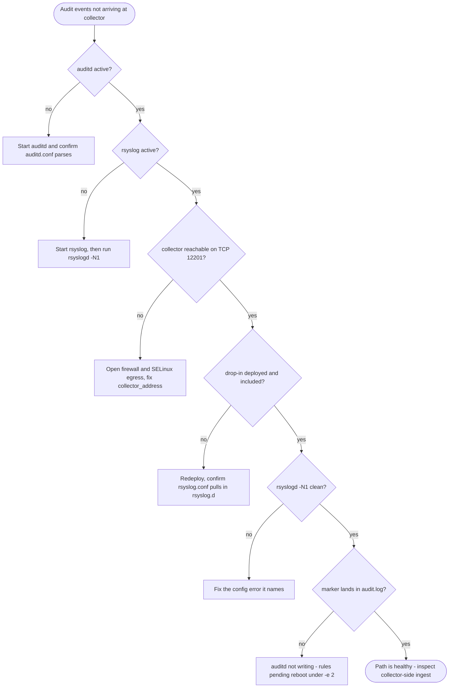

<!--
Project:      HyperI Linux audit collector
File:         docs/troubleshooting.md
Purpose:      Diagnostic guide -- the common failures deploying the audit
              collector role, each as symptom -> cause -> fix.
License:      Apache-2.0
Copyright:    (c) 2026 HYPERI PTY LIMITED
-->

# Troubleshooting

Deploy failures fall into a short list, and most are named by the error text the
run prints. Find the symptom heading below, read the cause, apply the fix. If a
clean deploy is still not landing events, jump to [events are not
arriving](#events-are-not-arriving-at-the-receiver) - that is the diagnosis with
the most moving parts.

For the happy path see [getting started](getting-started.md); for the deploy
internals these symptoms trace back to, see [ARCHITECTURE.md](../ARCHITECTURE.md).

## `'_AnsiblePathHookFinder' object has no attribute 'find_spec'`

Or another Python / import error when deploying to an el6-era target.

- **Cause.** Modern `ansible-core` needs a Python the old endpoint does not
  ship, and ansible-core 2.12 (the last line that reaches those hosts) predates
  the CPython 3.12 import-hook change - so it installs against a newer
  interpreter and then dies at run time.
- **Fix.** Pin an older ansible AND its interpreter on the control node. `uv`
  fetches both into a throwaway environment:

```sh
uvx --python 3.10 --from ansible==5.10 ansible-playbook \
    -i environments/<your-inventory> site.yml
```

The `--python 3.10` pin is not optional. Full rationale and the frozen version
table in [deploying to legacy targets](deploying-to-legacy-targets.md).

## `no matching key exchange method found`

Connecting to an old host.

- **Cause.** Current OpenSSH on the control node has disabled the key-exchange
  algorithms the old endpoint still offers. The error names the algorithm the
  target actually offered.
- **Fix.** Re-enable that one algorithm on the command line, not in the control
  node's global SSH config:

```sh
ansible-playbook -i environments/<your-inventory> site.yml \
    --ssh-common-args='-o KexAlgorithms=+<algorithm from the error>'
```

See [deploying to legacy targets](deploying-to-legacy-targets.md).

## The play fails immediately with a `collector_address` error

Task `Ensure collector_address is set` fails with `Collector_address is not set`.

- **Cause.** `collector_address` is required and has no default - the run fails
  before it touches the host.
- **Fix.** Set it in the inventory `vars:` block, or pass it inline:

```sh
ansible-playbook -i environments/<your-inventory> site.yml \
    -e collector_address=203.0.113.9
```

The variable is documented in [configuration](configuration.md).

## `hyperi_audit_profile_override must be one of ...`

Or `hyperi_audit_level must be one of low|medium|high` - the play fails fast at a
validation task rather than later at a confusing "source not found".

- **Cause.** An unknown profile or level value. Both are validated up front in
  `tasks/main.yml`.
- **Fix.** Use a permitted value. `hyperi_audit_level` accepts `low`, `medium`
  (default) or `high`. `hyperi_audit_profile_override` accepts `low`, `medium`,
  `high` or `internet`, and **replaces** the level rather than layering on it -
  so setting it alongside a non-default level only warns, and the level is
  discarded. See [configuration](configuration.md).

## Events are not arriving at the receiver

The deploy is green but no audit records reach the collector. The pipeline is
`kernel -> auditd -> /var/log/audit/audit.log -> rsyslog imfile -> omfwd TCP
12201 -> collector` ([ARCHITECTURE.md](../ARCHITECTURE.md)). Walk it in order -
the first failing link is the fault.



Each check as an ad-hoc command from the control node (`-b` escalates to root):

1. **auditd running.** `systemctl is-active auditd` on systemd hosts; on the el6
   floor (SysV init) use `service auditd status`. The role probes the init type,
   so match it to the host:

```sh
ansible all -i environments/<inv> -b -m command -a "systemctl is-active auditd"
```

2. **rsyslog running.** Same, for `rsyslog`. If either is not `active`, start it
   and read the next check - a config error keeps rsyslog down.

3. **Collector reachable on TCP 12201 from the host.** Audit records use 12201;
   general syslog uses 12205. Both must be open end to end:

```sh
ansible all -i environments/<inv> -b -m wait_for \
    -a "host=<collector> port=12201 timeout=15"
```

4. **Drop-in deployed, and `/etc/rsyslog.conf` reads `/etc/rsyslog.d`.** The
   forwarder lands at `/etc/rsyslog.d/99-hyperi-rsyslog.conf`, but it is only
   parsed if the main config includes that directory. The role probes for both
   the legacy `$IncludeConfig` and the modern `include(` forms - check the same
   way:

```sh
ansible all -i environments/<inv> -b -m command \
    -a "grep -E '(IncludeConfig|include).*rsyslog.d' /etc/rsyslog.conf"
```

5. **`rsyslogd -N1` reports a clean config.** This validates the config without
   restarting the daemon. A duplicate include or a bad directive shows here:

```sh
ansible all -i environments/<inv> -b -m command -a "rsyslogd -N1"
```

6. **The record is actually in `/var/log/audit/audit.log`.** imfile only
   forwards what auditd writes. If the file is not growing, the fault is upstream
   of rsyslog - auditd, or rules that never loaded (see below):

```sh
ansible all -i environments/<inv> -b -m command -a "tail -n 5 /var/log/audit/audit.log"
```

> **Note:** where SELinux is enforcing, egress on 12201/12205 needs the
> `semanage port` grant the role applies. If it did not run (SELinux was not
> detected as enabled at deploy time) `syslogd_t` cannot connect out, and step 3
> fails even though the collector is up. See the SELinux egress half in
> [ARCHITECTURE.md](../ARCHITECTURE.md).

## auditd will not stop or restart

The `Stop auditd` or `Start auditd` service task fails loudly mid-run.

- **Cause.** The kernel audit config is immutable (`-e 2`, the last line of every
  ruleset the role ships). On some older `auditd` in range a manual stop can be
  refused while immutable, and the restart task then fails rather than swallowing
  it. Whether the stop is actually refused is **UNVERIFIED** - it cannot be
  reproduced in a container, because audit netlink is host-global and the harness
  never runs the service path. A loud failure on a throwaway host is the intended
  trade.
- **Fix.** The failure is telling you the truth: new **rules** cannot load until
  the host reboots under `-e 2`. The daemon-side `auditd.conf` tuning still
  applies on the restart. So reboot the host to load the ruleset, and do not
  re-gate the restart on immutability. Prove this on real hardware per distro
  family before a production rollout - that is [Stage 0's
  job](deploying-to-a-fleet.md#stage-0s-job-prove-the-immutable-stop-question).

## SELinux policy build fails

`make: /usr/share/selinux/devel/Makefile: No such file`, or the role's own
`SELinux policy devel tooling missing` failure.

- **Cause.** `policycoreutils-devel` is absent. The role installs it, but with a
  soft failure, so its absence is otherwise silent - and the `make` of the
  `rsyslog_read_audit_logs` policy module then has no Makefile. The role now
  stats the Makefile and fails with an actionable message instead of an opaque
  make error.
- **Fix.** Install the devel package for the distro, then re-run:

```sh
ansible all -i environments/<inv> -b -m package -a "name=policycoreutils-devel state=latest"
```

On el7 that is `yum install policycoreutils-devel`; on el8/el9,
`dnf install policycoreutils-devel`.

## rsyslog logs a config error or a duplicate ruleset

`rsyslogd -N1` reports a duplicate ruleset or a parse error after deploy.

- **Cause.** Modern EL already pulls in `/etc/rsyslog.d` via
  `include(file="/etc/rsyslog.d/*.conf" ...)`, which a plain string match cannot
  see. The role probes for both include forms to avoid appending a second one -
  but a hand-added `$IncludeConfig /etc/rsyslog.d/*.conf` on a host that already
  has the modern `include(` duplicates it, so the drop-in (imfile plus the
  `remote_auditd` ruleset) is parsed twice.
- **Fix.** Run `rsyslogd -N1` (step 5 above), find the duplicate include, and
  remove the hand-added line. Leave the role's probe to manage it.

## A whole batch aborted mid fleet-rollout

One host failed and the entire `serial` batch stopped.

- **Cause.** That is `max_fail_percentage: 0` working as designed - the first
  failing host in a batch aborts the play, so a bad change cannot ripple across
  the fleet.
- **Fix.** Correct the variables, then re-target only the hosts that failed with
  ansible's retry file:

```sh
ansible-playbook -i environments/<inv> site.yml --limit @site.retry
```

The staged model, the health gate and the retry pattern are in [deploying to a
fleet](deploying-to-a-fleet.md).

## See also

- [Getting started](getting-started.md) - deploy and verify one host.
- [Configuration](configuration.md) - every role variable and the profiles.
- [Deploying to legacy targets](deploying-to-legacy-targets.md) - pinned ansible
  and the old-cipher SSH workaround.
- [Deploying to a fleet](deploying-to-a-fleet.md) - batched rollout and rollback.
- [ARCHITECTURE.md](../ARCHITECTURE.md) - the pipeline and the maintainer
  invariants these failures trace back to.
